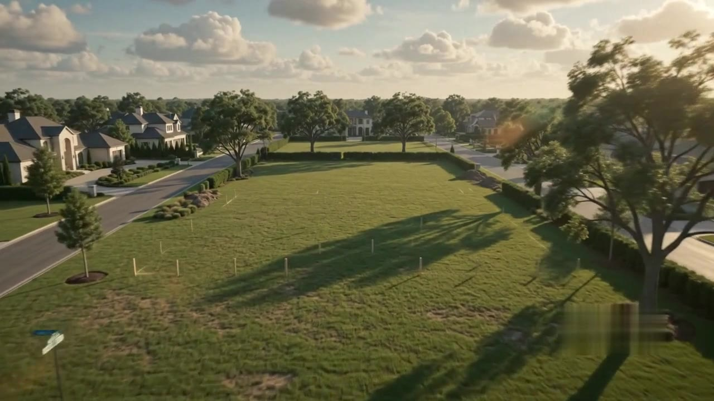

# Velmont Estates — *From Vision to Reality*

An Awwwards-calibre, cinematic luxury real-estate experience built around a single
pre-produced mansion film. The visitor doesn't browse pages — they watch a residence
come to life, cross an almost-invisible threshold from film into website, and then
walk the house room by room.



> **Live:** _deploying to Vercel — link to be added._
> **Repo:** https://github.com/navjot110099/velmont-estates
>
> A cinematic, front-end experience — no backend, auth, payments, database, CMS, or
> live listings; every interaction is visual, immersive, and film-driven.

---

## Overview

The mansion **becomes** the website. Each section is a **room**, and scrolling walks
you through the house from the Grand Entrance up to the Rooftop Terrace:

| Floor | Room | Section |
|------|------|---------|
| 00 | Grand Entrance | Cinematic film → invisible handoff |
| 01 | Living Room | About · Vision · Mission |
| 02 | Kitchen | Services |
| 03 | Dining Room | Featured Residences |
| 04 | Wine Cellar | Exclusive Collection |
| 05 | Executive Office | Why Velmont · Timeline · Awards |
| 06 | Home Theater | Testimonials |
| 07 | Master Suite | Lifestyle |
| 08 | Walk-in Closet | Features & Amenities |
| 09 | Spa Bathroom | Materials & Craftsmanship |
| 10 | Wellness Area | Investment & Future |
| 11 | Rooftop Terrace | Contact · CTA · Footer |

## The hero

`components/CinematicHero.tsx` pins the mansion film in a tall scroll stage and
**scrubs `video.currentTime` from scroll position** through a requestAnimationFrame
lerp, so the footage feels hand-eased rather than snapped (Apple-style). As the camera
settles inside the finished residence, the final frame is held and the Grand Entrance
resolves over it — the film-to-site transition is designed to be nearly invisible.

## Stack

- **Next.js 14** (App Router) + **TypeScript**
- **Tailwind CSS** for the design system (`tailwind.config.ts`, `app/globals.css`)
- **Framer Motion** for all motion
- **Lenis** for premium smooth scrolling (`components/SmoothScroll.tsx`)
- Curated luxury photography with graceful gradient fallbacks (`components/ui/LuxuryImage.tsx`)

## Performance notes

The hero film is the heaviest asset on the site, so it gets the most attention.

**Encoding.** A single ~58 MB master is transcoded into four scrub-friendly variants
plus a poster (see [`scripts/encode-hero.mjs`](scripts/encode-hero.mjs)). The browser
is handed both formats at both resolutions and picks the smallest it can play:

| Variant | Codec | Resolution | Size |
|---|---|---:|---:|
| `mansion-desktop.webm` | VP9 | 1280×720 | ~15 MB |
| `mansion-desktop.mp4` | H.264 | 1280×720 | ~19 MB |
| `mansion-mobile.webm` | VP9 | 720×404 | ~5.8 MB |
| `mansion-mobile.mp4` | H.264 | 720×404 | ~6.9 MB |
| `mansion-poster.jpg` | JPEG | 1280×720 | ~0.1 MB |

A phone on VP9 therefore pulls **~5.8 MB** instead of the original 58 MB (~90% less),
and the audio track is dropped entirely (the hero is always muted).

**Scrub smoothness.** Two things make seeking feel buttery on mid-range hardware:

1. **A dense GOP** — the film is encoded with a keyframe every ~0.5 s (`-g 12` at
   24 fps). Precise `currentTime` seeks only have to decode a few frames from the
   nearest keyframe, so they stay cheap and accurate (no `fastSeek` snapping).
2. **A frame-rate-independent lerp** — `currentTime` eases toward the scroll target
   with an exponential time-constant driven by the real frame delta, so the feel is
   identical at 30, 60, or 120 Hz. The loop only touches media properties (never
   geometry), so there's no layout thrash, and it idles once the film has handed off.

**Loading.**

- `preload="metadata"` — only the header is fetched up front; the footage streams in
  via range requests as the viewer scrubs.
- The `<video>` is attached **after mount** (client-side), so the initial HTML is a
  lightweight poster hero and the film download never blocks first paint.
- The poster still is the LCP element and loads eagerly.

**Reduced motion.** Under `prefers-reduced-motion: reduce`, the hero never scrubs:
it collapses to a single-screen poster still, Lenis inertia is disabled, and
Framer Motion transforms are skipped (`MotionConfig reducedMotion="user"`).

## Accessibility & SEO

- Reduced-motion fallbacks throughout (hero, smooth-scroll, global CSS).
- Single, meaningful `<h1>`; the loading curtain is exposed as a `role="status"`
  and its decorative wordmark is hidden from assistive tech.
- "Skip to content" link, focusable `<main>`, visible focus rings tuned for
  contrast on both ink and marble surfaces.
- Decorative layers (film, gradients, scroll cues) are `aria-hidden`.
- Full Open Graph + Twitter card metadata, canonical URL, and
  `RealEstateAgent` JSON-LD (`app/layout.tsx`). Set `NEXT_PUBLIC_SITE_URL` in the
  environment so canonical/social URLs resolve absolutely in production.

## Project structure

```
app/            layout, metadata, page composition, globals
components/      hero, nav, preloader, floor indicator, smooth-scroll
  sections/      the 12 rooms
  ui/            reusable motion primitives
data/site.ts     all content
public/videos/   encoded hero variants + poster
public/og.jpg    social share image
scripts/         encode-hero.mjs (regenerates the hero variants)
lib/anim.ts      shared easing + variants
```

## Run

```bash
npm install
npm run dev      # http://localhost:3000
```

Build:

```bash
npm run build && npm start
```

## Re-encoding the film

The ~58 MB master is intentionally **not committed**. To regenerate the hero variants
from your own master, point the script at it:

```bash
# uses a system ffmpeg, or: npm i -D ffmpeg-static  (then it's picked up automatically)
node scripts/encode-hero.mjs /path/to/mansion-master.mp4
```

Outputs land in `public/videos/` (and `public/og.jpg`). See the header of
[`scripts/encode-hero.mjs`](scripts/encode-hero.mjs) for the rationale behind every flag.

---

© Velmont Estates
